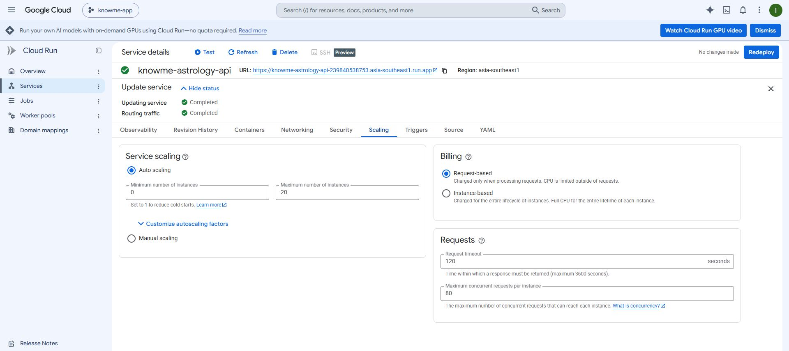

# KnowMe Cloud Run cost control — 2026-11-03

## Result

The recurring always-warm compute configuration has been removed from the
Production astrology API under the owner's explicit instruction to minimize
cost before the product earns revenue. This is a runtime configuration change
using the identical existing image, not an application release.

- Project: `knowme-app-694e1`; region: `asia-southeast1`.
- Applied at Ready transition: `2026-11-03T09:59:46.245941Z` (16:59:46 Thailand).
- Previous: `knowme-astrology-api-00014-j2z`, revision min `1`, instance-based CPU.
- New: `knowme-astrology-api-00015-gws`, revision min `0`, request-based CPU,
  100% traffic, Ready/ConfigurationsReady/RoutesReady true.
- Service-level minimum remains `0`; maximum remains `20` (revision max `10`).
- Exact retained image: `sha256:fc7822d48c3ad7d93bd91bb822308e232a11b8d498fc1b7a6e7e896172dccd50`.
- Retained resources: 1 CPU, 512Mi RAM, concurrency 80, timeout 120 seconds,
  startup CPU boost and startup probe. Service account, environment, ingress,
  CORS and traffic policy were preserved.

The copied live YAML spec before/after matched exactly after substituting only
`autoscaling.knative.dev/minScale: 1 -> 0` and
`run.googleapis.com/cpu-throttling: false -> true`. This also exposes an
important distinction: the console's service-level minimum already said 0,
but the old revision still pinned one instance. Changing the service field
alone would not have removed that revision setting.

[Sanitized observations](qa/cloudrun-cost-control-20261103/observations.json)

## Why this removes the fixed idle-compute pattern

October billing was THB1,877.02 Cloud Run + THB5.07 Artifact Registry +
THB131.75 VAT = THB2,013.84. The instance-based CPU SKU recorded
2,679,418.67 CPU seconds, approximately a full 31-day month at one CPU.
This was entirely on project `knowme-app-694e1`.

Request-based billing with both minimums at zero allows instances to sleep and
charges compute for requests/startup/shutdown rather than keeping a reserved
CPU running all month. It does not erase accrued costs, storage, database,
network or actual request costs. Post-change monthly totals are not known yet.

## Risk and verification

- Read current Production source, deployment script, September latency
  closeout, and PR149 trial release status before changing configuration.
- Production FastAPI startup initializes Firebase and synchronously awaits a
  read-only Firestore warmup; normal calculation/save handlers finish before
  response. No always-running/background requirement was found in the reviewed
  entrypoints. Auth checks and awaited atomic save code are not changed.
- The prior min-1/always-allocated CPU was a latency optimization. Firestore
  remains in africa-south1 while Cloud Run is in asia-southeast1. First-use and
  reconnection latency may increase; do not claim the old latency acceptance
  measurements still apply to the new cost policy.
- Before/after `GET /health` via the public Production endpoint returned
  `{"status":"ok","service":"knowme-astrology-api"}`.
- Provider reports the new revision Ready with 100% traffic; exact service-spec
  comparison confirms only the two intended cost settings changed.
- Separate trial calculator `knowme-overall-pr149-preview-00004-kt9` was already
  request-based with zero minimum. It was inspected, not redeployed.
- Full authenticated calculation/save regression and an observed real
  idle-to-zero-to-wake cycle remain unverified in this run. No QA accounts or
  birth/profile records were created or modified for smoke tests.
- Deployment script flag spelling was checked against current official gcloud
  documentation. The deployment script itself was not executed: doing so would
  rebuild source and run unrelated pre-existing IAM setup.
- Default main has no `.github/workflows` files. Do not invent a CI pass; check
  the new PR's actual provider status before merging.

## Deployment defaults

`scripts/deploy_astrology_api.ps1` now specifies `--cpu-throttling`, service
`--min 0`, and revision `--min-instances 0`. The existing CPU/RAM/max/timeout,
verification and other script steps are preserved. This prevents routine future
deployments using that script from restoring a permanently warm revision.

This change does not merge PR #149 or deploy its trial bundle over the main
Hosting site. The trial continues to use its separate compute-only calculator;
no new result persistence is added to that privacy-guarded path.

## Post-merge verification

- PR [#150](https://github.com/notekmitl/knowme/pull/150) merged as
  `b776895317cd72ef1ac16d3f894e02e054b0b5c9`. Read back the default-branch script;
  all three zero-idle-cost flags are present. No CI statuses/checks were returned;
  no automated CI run is claimed for this script/documentation change.
- At `2026-11-03T10:14:22.491Z`, the existing signed-in main site successfully
  displayed its stored Western result after opening the astrology menu.
  No regenerate/profile-edit action was selected. Observed browser console
  errors: 0. This does not certify new authenticated generation/save.
- Provider monitoring shows a displayed billable container-time rate near
  `1.002 s/s` before the change, and `0.013 s/s` for the 17:10 Thailand sample
  after the change. The sample demonstrates a drop in billed compute time;
  it is not a monthly bill forecast and does not prove an observed zero-to-wake
  cycle. Actual post-change billing still needs to accrue.

## Rollback

Retain old revision `knowme-astrology-api-00014-j2z`; do not delete it or its
Artifact Registry image. If request-based startup/reconnection causes an actual
service failure, restore that revision's traffic or redeploy the retained image
with revision min `1` and CPU throttling `false`, preserving all other settings.
That rollback deliberately restores idle compute cost. Investigate evidence
rather than silently reverting the cost-first choice for latency alone.

## Official references

- https://docs.cloud.google.com/run/docs/configuring/billing-settings
- https://docs.cloud.google.com/run/docs/configuring/min-instances
- https://docs.cloud.google.com/sdk/gcloud/reference/run/deploy
